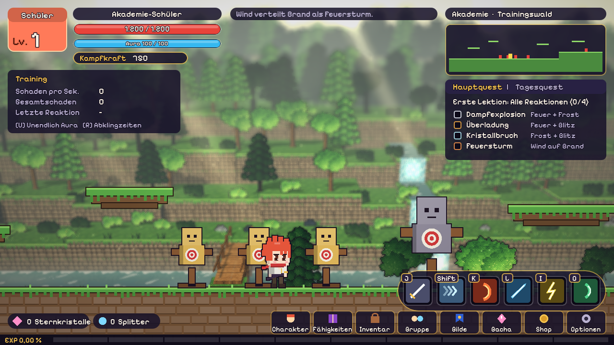
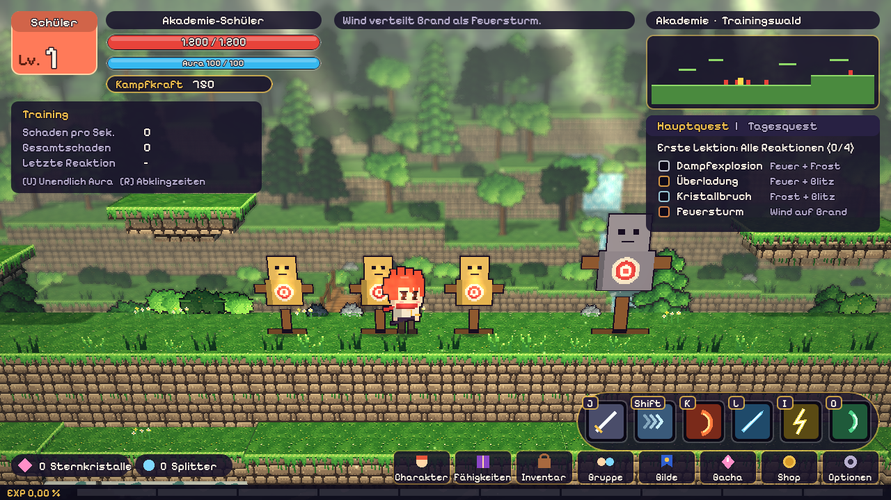

# Chibi Legends

2D-Action-Plattformer im Pixel-Art-Stil für den Browser, gebaut mit **Godot 4.3** (GDScript, Web-Export).
Spielwelt: die Multiversum-Akademie. Fähigkeiten und Outfits sind eigene Entwürfe nach typischen Anime-Archetypen.


## Stand: Phase 1 (Fundament)

- Chibi-Spielfigur (ca. 32 × 48 Pixel, in Ebenen gezeichnet) mit Laufen, Doppelsprung, Dash und Durch-Plattform-Fallen
- Katana-Combo mit drei Hieben und vier Fähigkeiten: Flammenschnitt, Frostlanze, Kettenblitz, Sturmklinge
- Element-Reaktionen: Dampfexplosion, Überladung, Kristallbruch, Feuersturm
- Trainingswald mit Trainingspuppen, Schaden pro Sekunde, Gesamtschaden und Reaktions-Quest
- HUD: Leisten oben links, Minikarte und Quests oben rechts, Fähigkeiten-Leiste und Menüleiste unten
- Tastatur und Gamepad

## Steuerung

| Aktion | Tastatur | Gamepad |
| --- | --- | --- |
| Laufen | A / D oder Pfeiltasten | Linker Stick / Steuerkreuz |
| Springen (2x = Doppelsprung) | Leertaste, W oder Pfeil hoch | A |
| Durch Plattform fallen | S + Leertaste | Unten + A |
| Dash | Shift | B |
| Katana-Combo | J | X |
| Fähigkeiten 1–4 | K, L, I, O (oder 1–4) | Y, RB, LB, RT |
| Unendlich Aura / Abklingzeiten zurücksetzen | U / R | – / Back |
| Look wechseln | C | Start |
| Hilfe ein/aus | H | – |
| HD-2D-Test: Ansicht wechseln (flach / A / B) | B | – |
| HD-2D-Test: Grafik Hoch / Mittel / Niedrig | G | – |

## HD-2D-Look (Test)

Zwei Varianten zum Vergleich, beide im Trainingswald, Stimmung „sonniger Morgen“:

- **A, 3D-Kulisse:** Die Spielebene bleibt 2D. Dahinter steht der Wald als echte 3D-Kulisse mit Fluss, Holzbrücken und Wasserfall.
- **B, alles 3D:** Boden, Plattformen und Umgebung sind 3D, die Kamera schaut leicht von oben. Die Spiellogik bleibt der bewährte 2D-Code: Figuren, Angriffe und Effekte werden in eine eigene 2D-Ansicht gezeichnet und stehen als Karte auf der Spiellinie.

Effekte: Tiefenunschärfe (auf „Hoch“ echte Tiefe, sonst Tilt-Shift), Bloom, Dunst und Nebel über dem Fluss, Lichtstrahlen, Pollen, Wasser mit Spiegelung (nur „Hoch“) und Sonnenschatten.
Der Browser-Renderer (GL Compatibility) hat dafür keine fertigen Effekte, darum ist die Kette selbst gebaut (`shaders/hd2d/`).
Alle Grafiken sind eigene Pixel-Art aus `tools/hd2d/gen_textures.py`.

Im Web-Build lässt sich die Ansicht per URL wählen: `?view=flat`, `?view=a`, `?view=b`, dazu `&q=0` bis `&q=2` für die Grafikstufe.

| A: 3D-Kulisse | B: alles 3D |
| --- | --- |
|  |  |

## Starten

**Im Godot-Editor:** Godot 4.3 öffnen, `project.godot` importieren, F5 drücken.

**Als Web-Build:** Jeder Push baut über GitHub Actions einen Web-Export (Artefakt `chibi-legends-web`).
Entpacken und über einen lokalen Server öffnen, z. B. `python3 -m http.server` im Ordner, dann `http://localhost:8000`.
Optional: GitHub Pages einrichten und die Repo-Variable `DEPLOY_PAGES=true` setzen, dann wird automatisch veröffentlicht.

## Aufbau

```
scripts/
  autoload/game_input.gd   Eingaben (Tastatur + Gamepad)
  data/game_data.gd        Elemente, Fähigkeiten, Reaktionen, Looks (reine Daten)
  combat/reactions.gd      Reaktionsregeln (reine Logik, später auch auf dem Server)
  combat/attack.gd         Hitboxen und Geschosse
  entities/                Spieler, Chibi-Grafik, Trainingspuppe
  world/                   Trainingswald und Parallax-Hintergrund
  fx/                      Schadenszahlen und Pixel-Effekte
  ui/hud.gd                HUD
  hd2d/                    HD-2D-Test: 3D-Wald, Effekt-Kette, Variante A und B
shaders/hd2d/              Shader für Gelände, Wasser, Unschärfe, Bloom
tools/hd2d/                Generator für die Pixel-Texturen (assets/hd2d/)
```

Daten und Reaktionslogik hängen nicht an Szenen. Dadurch kann der spätere Godot-Headless-Server (Koop, Phase 4) denselben Code nutzen.

## Roadmap

1. **Fundament** (dieser Stand)
2. **Kernspiel:** alle 12 Fähigkeiten, Stil-Set-Boni, ausführliches Customizing, 5 Story-Level mit Boss, Wellen-Arena, Touch-Steuerung
3. **Online-Basis:** Supabase-Accounts, Cloud-Speicher, Gilden mit Chat, Bestenlisten
4. **Koop:** Godot-Server auf Fly.io, Gruppen bis 4 Spieler
5. **Gacha und Shop:** Banner, Pity, Stripe (Echtgeld erst nach Rechtsprüfung)

Grafik ist vorerst prozedural gezeichnet. Echte Sprites (z. B. aus PixelLab) ersetzen später die Ebenen in `chibi_visual.gd`.

## Lizenzen

Schrift: Pixelify Sans, SIL Open Font License 1.1 (siehe `assets/fonts/OFL-NOTICE.txt`).
