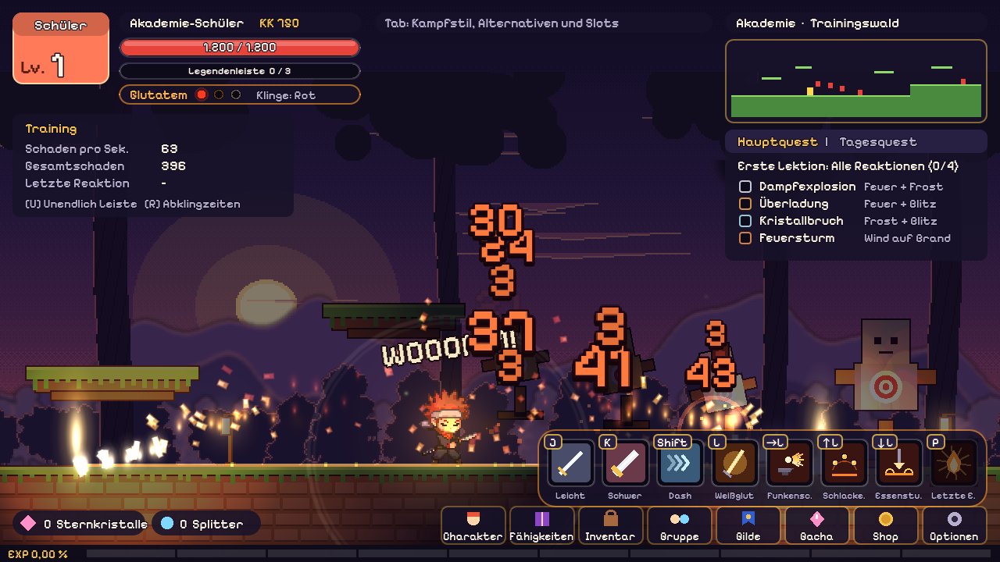

# Chibi Legends

2D-Action-Plattformer im Pixel-Art-Stil für den Browser, gebaut mit **Godot 4.3** (GDScript, Web-Export).
Spielwelt: die Multiversum-Akademie. Fähigkeiten und Outfits sind eigene Entwürfe nach typischen Anime-Archetypen.


## Stand: Phase 1 (Fundament)

- Chibi-Spielfigur (ca. 32 × 48 Pixel, in Ebenen gezeichnet) mit Laufen, Doppelsprung, Dash und Durch-Plattform-Fallen
- Kampfsystem (Prototyp): Leicht, Schwer und Spezial, jeweils mit Richtung (neutral, vor, oben, unten, Luft), Leicht-Kette mit 3 Hieben, Griff, Abbrechen in stärkere Angriffe nach einem Treffer, Puppen lassen sich hochschleudern. Angriffswerte stehen als Bilder-Daten (60 fps) in `assets/combat/movesets/`, siehe `docs/kampfsystem.md`
- Testfigur 2 (Manga-Chibi-Stil) als Kämpfer; T schaltet auf die Figur aus der Sammlung
- Erster Kampfstil **Glutatem** (Feueratmung, Thema Schmiede, Design: `assets/combat/styles/glutatem.json`): eigenes J/K-Moveset, 6 Züge auf der Spezial-Taste (4 Slots), jeder mit 3 Alternativen, Meisterzug mit 3 Varianten. Atemrhythmus: verschiedene Züge im Combo heizen die Klinge (Rot, Orange, Weiß), bei Weiß bekommt der nächste Zug einen Extra-Treffer. Legendenleiste mit 3 Stufen (L halten = verstärkter Zug, P = Meisterzug). Effekte im M.U.G.E.N-Stil, weich gezeichnet (Funken, Glut, Rauch, Lautwörter, Lichtblitze)
- Abendlicht im Trainingswald: Dämmerungs-Tönung, echte 2D-Lichter (Laternen, Schmiede-Esse, Kristalle, Glühwürmchen, jedes Feuer leuchtet), Pixel-Licht-Shader mit runden Normalen für die Figuren, Parallax-Diorama. N schaltet es aus und an, `?abend=0` in der Web-URL startet ohne
- Sparringspfahl, der zurückschlägt und Holzscheite wirft (zum Testen von Konter, Zurückwerfen und Funkenschild)
- Element-Reaktionen: Dampfexplosion, Überladung, Kristallbruch, Feuersturm
- Trainingswald mit Trainingspuppen, Schaden pro Sekunde, Gesamtschaden und Reaktions-Quest
- HUD: Leisten oben links, Minikarte und Quests oben rechts, Fähigkeiten-Leiste und Menüleiste unten
- Tastatur und Gamepad
- Kampfeffekte im Stil klassischer 2D-Fighter: Trefferpause (Hit-Stop), Screenshake, leuchtende Treffer-Funken je Element, große Reaktions-Explosionen und der Super „Legendenstrahl“ (Bildschirm-Abdunkeln, Cut-in, Energiestrahl, Finale). Stärke per V umschaltbar.



## Steuerung

| Aktion | Tastatur | Gamepad |
| --- | --- | --- |
| Laufen | A / D oder Pfeiltasten | Linker Stick / Steuerkreuz |
| Springen (2x = Doppelsprung) | Leertaste | A |
| Richtung oben / unten | W / S oder Pfeiltasten | Linker Stick / Steuerkreuz |
| Durch Plattform fallen | S + Leertaste | Unten + A |
| Dash (in der Luft 1x pro Sprung) | Shift | RB |
| Leicht (3er-Kette, mit Richtung: vor, oben, unten, Luft) | J | X |
| Schwer (mit Richtung) | K | Y |
| Zug von Glutatem: neutral, vor, oben, unten = Slot 1–4 | L | B |
| Verstärkter Zug (kostet 1 Stufe Legendenleiste) | L halten | B halten |
| Griff (Wurf) | J + K zusammen | X + Y |
| Meisterzug (3 Stufen Legendenleiste) | P | LT |
| Kampfstil: Alternativen, Slots, Meisterzug wählen | Tab oder M | LB |
| Abendlicht an/aus | N | – |
| Figur wechseln (Testfigur / Sammlung) | T | – |
| Effekt-Stärke (Dezent / Kräftig / Maximal) | V | – |
| Unendlich Legendenleiste / Abklingzeiten zurücksetzen | U / R | – / Back |
| Charaktere (Sammlung) | C | Start |
| Hilfe ein/aus | H | – |

## Starten

**Im Godot-Editor:** Godot 4.3 öffnen, `project.godot` importieren, F5 drücken.

**Als Web-Build:** Jeder Push baut über GitHub Actions einen Web-Export (Artefakt `chibi-legends-web`).
Entpacken und über einen lokalen Server öffnen, z. B. `python3 -m http.server` im Ordner, dann `http://localhost:8000`.
Optional: GitHub Pages einrichten und die Repo-Variable `DEPLOY_PAGES=true` setzen, dann wird automatisch veröffentlicht.

## Aufbau

```
scripts/
  autoload/game_input.gd   Eingaben (Tastatur + Gamepad)
  data/game_data.gd        Elemente, Fähigkeiten, Reaktionen, Looks (reine Daten)
  combat/reactions.gd      Reaktionsregeln (reine Logik, später auch auf dem Server)
  combat/attack.gd         Hitboxen und Geschosse
  combat/super_beam.gd     Super-Angriff mit Super-Flash, Strahl und Finale
  combat/fighting_style.gd Kampfstil aus JSON: Züge, Alternativen, Slots, Meisterzug, Speicherstand
  glutatem/                Kampfstil Glutatem: Züge und Atemrhythmus (glut_caster), Meisterzug
                           (glut_super), Feuer-Effekte (glut_fx), Glut am Boden (glut_hazard),
                           Abendlicht (dusk_stage), Sparringspfahl, Skill-Icons
  ui/glutatem_menu.gd      Kampfstil-Menü (Tab)
  entities/                Spieler, Chibi-Grafik, Trainingspuppe
  world/                   Trainingswald und Parallax-Hintergrund
  fx/                      Schadenszahlen und Pixel-Effekte
  fx/combat_fx.gd          Hit-Stop, Screenshake, Zoom, Abdunkeln, Bildschirm-Blitz
  fx/hit_sparks.gd         Additive Treffer-Funken (optional mit Pixel-Frames aus assets/vfx/)
  fx/fx_settings.gd        Treffer-Profile und Effekt-Stärke zum Feintunen
  ui/hud.gd                HUD
  ui/character_select.gd   Sammlung: Charaktere ansehen, Skins, Charakter wählen (C / Start)
  character/roster.gd      Feste Charaktere, Seltenheit, Skins, Besitz und Auswahl
  character/appearance.gd  Sprite-Teile, Farben und Paletten für den Shader
assets/characters/         Charaktere, Skins, Sprite-Teile und Farben, siehe assets/characters/README.md
tools/sprites/             Format, Platzhalter backen, Prüfen, Vorschau (Python + Pillow)
tools/pixellab/            Neue Charaktere/Teile mit PixelLab erzeugen oder eigene PNGs importieren
```

Daten und Reaktionslogik hängen nicht an Szenen. Dadurch kann der spätere Godot-Headless-Server (Koop, Phase 4) denselben Code nutzen.

## Roadmap

1. **Fundament** (dieser Stand)
2. **Kernspiel:** alle 12 Fähigkeiten, Stil-Set-Boni, ausführliches Customizing, 5 Story-Level mit Boss, Wellen-Arena, Touch-Steuerung
3. **Online-Basis:** Supabase-Accounts, Cloud-Speicher, Gilden mit Chat, Bestenlisten
4. **Koop:** Godot-Server auf Fly.io, Gruppen bis 4 Spieler
5. **Gacha und Shop:** Banner, Pity, Stripe (Echtgeld erst nach Rechtsprüfung)

Grafik ist vorerst prozedural gezeichnet. Echte Sprites (z. B. aus PixelLab) ersetzen später die Ebenen in `chibi_visual.gd`.

## Lizenzen

Schrift: Pixelify Sans, SIL Open Font License 1.1 (siehe `assets/fonts/OFL-NOTICE.txt`).
