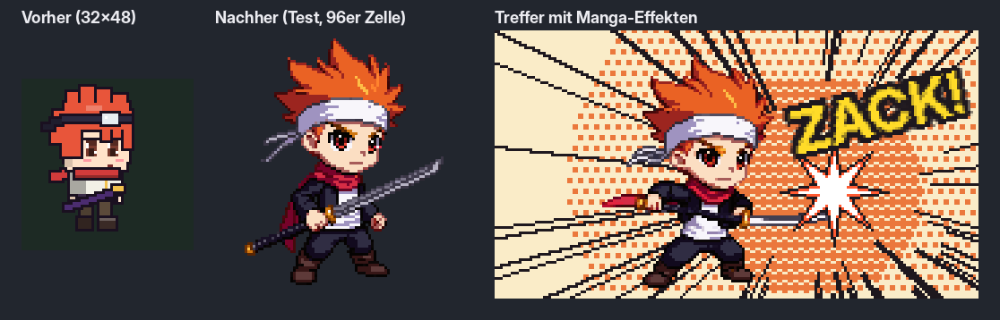

# Stil-Leitfaden: Manga-Chibi-Look

Ziel: Das Spiel soll sich anfühlen wie die DS-Anime-Prügler der 2000er (Vorbild für das Gefühl: Jump Ultimate Stars). Das ist nur Inspiration. Alle Figuren, Effekte und Bildschirme sind eigene Entwürfe. Keine Sprites, Figuren, Logos oder UI-Elemente aus anderen Spielen übernehmen oder abpausen.

Entschieden am 2026-11-04: Figuren werden größer (ca. 48 × 64 px), dazu kommen Manga-Effekte. Die Panel-UI (Koma-Rahmen für Menüs und HUD) ist vorerst nicht dabei.

## Figuren

| Punkt | Regel |
|---|---|
| Zelle | 96 × 96 px pro Frame, Fußpunkt bei x 44, y 88, Blick nach rechts (links wird gespiegelt) |
| Figur | ca. 40–48 breit × 56–64 hoch, Waffe und Haare dürfen in die Zelle hinausragen |
| Proportionen | ca. 3 Köpfe: großer Kopf, aber echte Arme und Beine mit Ellbogen und Knien |
| Gesicht | große Anime-Augen mit 2 Glanzpunkten, Mimik muss in 3× Zoom lesbar sein |
| Umriss | 1 px, geschlossen und dunkel; an Haut ein dunkler Hautton, sonst fast schwarz; Innenlinien selektiv |
| Schattierung | Cel-Shading, 2–3 Töne pro Material, harte Kanten, kein Dithering, Figur gesamt 12–16 Farben |
| Farben | hell und satt, jede Figur hat 1 Signaturfarbe, die auch Aura und Effekte färbt |
| Silhouette | jede Figur muss schwarz gefüllt erkennbar sein (Haar, Waffe, Schal) |

## Animation

- Übertriebene Schlüsselposen, Squash & Stretch, Vorhol- und Nachschwung.
- Richtwerte: idle 4–6, run 8, Angriff 6–8, Treffer 2–3 Frames.
- Treffer-Frame eines Angriffs ist der weiteste Pose und hält 2–3 Frames länger (Hit-Stop).

## Manga-Effekte

- **Speedlines:** radiale Linien bei Supers und starken Treffern, gerade Linien beim Dash.
- **Halbton-Raster:** Punktraster im Hintergrund während eines Supers und im Cut-in.
- **Lautmalerei:** kurze eigene Wörter in fetter Schrift mit dickem Umriss (z. B. „BAM!“, „ZACK!“, „DOOM“), schräg gestellt, poppen auf und verblassen.
- **Treffer:** sternförmige Blitze statt runder Funken, weiß mit Signaturfarbe am Rand.
- Die bestehenden M.U.G.E.N-Effekte (Glühen, Shake, Hit-Stop) bleiben und werden ergänzt.

## Referenz: wie Figuren im DS-Vorbild aufgebaut sind

Beobachtungen aus Spielszenen und bekannter DS-Technik. Genaue Pixelmaße sind nicht öffentlich belegt, die Zahlen sind deshalb Schätzungen und dienen als Richtwert, nicht als Kopiervorlage.

**Größe im Bild.** Der DS-Bildschirm hat 256 × 192 px. Eine Kampffigur ist dort grob 40–60 px hoch, also etwa ein Viertel der Bildhöhe. Figuren behalten ihre Größenunterschiede zueinander: kleine Figuren sind sichtbar kleiner, große Kämpfer größer, statt alle gleich hoch zu sein.

**Proportionen.** Kein extremes 2-Kopf-Chibi, sondern eher ca. 3 Köpfe: der Kopf ist groß, aber Rumpf und Beine sind lang genug für klare Lauf-, Sprung- und Schlagposen. Hände und Füße sind leicht vergrößert, damit Angriffe lesbar sind. Die Haare sind die wichtigste Erkennungsform und dürfen über den Kopf hinaus stark übertrieben sein.

**Umriss.** 1 px, dunkel, geschlossen um die ganze Figur. Nicht überall reines Schwarz: an Haut und hellen Flächen ein dunkler Ton der Fläche, an Kleidung und Haaren fast schwarz. Innenlinien nur dort, wo sie Form erklären (Kinn, Arm vor dem Körper, Kleidungsfalte).

**Farben.** DS-Sprites nutzen meist 16-Farben-Paletten (15 Farben + transparent). Pro Figur also ca. 12–16 Farben gesamt, pro Material 2–3 Töne: Grundton, Schatten, ggf. Glanzlicht. Licht kommt einheitlich von oben vorn. Keine weichen Verläufe, kein Anti-Aliasing nach außen.

**Gesicht.** Auf so kleiner Fläche werden Augen zu 2–4 px hohen Formen mit einem hellen Glanzpixel, der Mund zu 1–2 px. Ausdruck entsteht über Augenform und Augenbrauen, nicht über Details.

**Blickrichtung.** Seitenansicht mit leichter Drehung zum Betrachter (Dreiviertel), damit Gesicht und Brust lesbar bleiben. Nach links wird gespiegelt.

**Animation.** Viele Frames für eine Handheld-Figur und klare Schlüsselposen: Angriffe mit deutlichem Ausholen, einer gehaltenen Trefferpose und kurzem Nachschwung. Jede Figur hat ein festes Grundset (Stand, Lauf, Sprung, leichter, starker, Aufwärts- und Abwärtsangriff, Spezial) plus Spezialbewegungen, die genau ihre Vorlage zitieren.

**Lesbarkeit.** Jede Figur muss als einfarbige Silhouette erkennbar sein und sich in Signaturfarbe und Haarform von allen anderen abheben.

### Was das für uns heißt

| Punkt | Testfigur (Stand PR #10) | Ziel nach Referenz |
|---|---|---|
| Höhe | ca. 92 px | ca. 56–64 px in der 96er Zelle |
| Proportion | ca. 2,2 Köpfe | ca. 3 Köpfe |
| Farben | 46 | 12–16 |
| Umriss | überall Schwarz | dunkel, an Haut farbig |
| Blick | Dreiviertel, gut | bleibt |

## PixelLab

- Standbilder: `create-image-pixflux` oder `create-image-pixen` mit 96 × 96, `view: side`, `direction: east`, `outline: single color black outline`.
- Animation: `animate-with-text-v3` ausgehend vom gewählten Standbild (bei 96 × 96 kosten bis zu 7 Frames 1 Generierung).
- Skripte: `tools/jus_style/`. Erste Testfigur: `assets/characters/jus_test/`.

