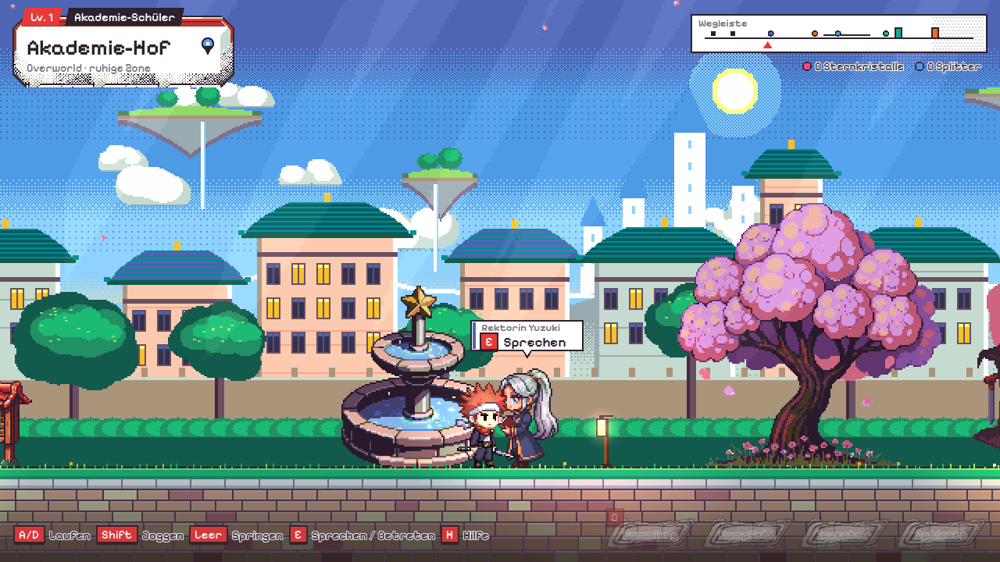
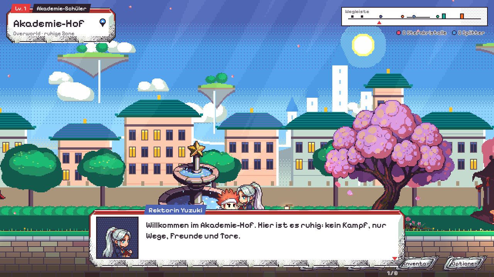
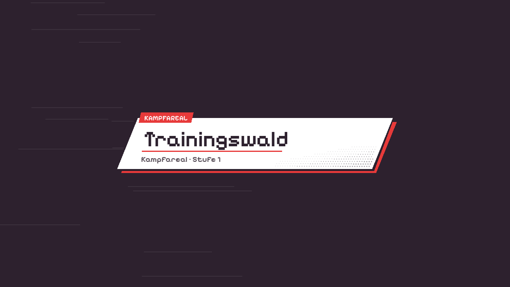

# Overworld und Kampfareale

Stand 2026-11-04. Das Spiel hat jetzt zwei getrennte Modi mit eigenem HUD:

| | Overworld (Akademie-Hof) | Kampfareal (Trainingswald) |
|---|---|---|
| Zweck | Erkunden, Treffpunkt, NPCs, Eingänge | Kämpfen, Training |
| Steuerung | Laufen, Joggen, Springen, Sprechen/Betreten | volles Kampf-Moveset |
| HUD | ruhig: Namensschild mit Ort, Wegleiste, Sprechblase über dem Ziel, Dialogfeld, wenige Knöpfe | Kampf-HUD (Leisten, Skills, Quests, Training) |
| Licht | klarer Vormittag, warme Sonne, Lichtstrahlen, Kirschblüten | Abenddämmerung (DuskStage) |



## Ablauf

- Das Spiel startet im **Akademie-Hof**. Eine Titelkarte nennt den Ort.
- Am **Waldtor** (rechts) mit **E** (oder W / Pfeil hoch, am Gamepad X) betreten: Manga-Blende, Titelkarte „Trainingswald · Kampfareal“, dann der Trainingswald mit dem Kampf-HUD.
- Im Trainingswald steht dasselbe Tor ganz links (von innen). Davor **E** oder W: zurück in den Hof, man steht dann vor dem Waldtor.
- Das **Tor der Glutschmiede** ist versiegelt (kommt mit dem nächsten Kampfareal).
- Web: `?modus=dungeon` startet direkt im Trainingswald, `?modus=overworld` im Hof.



## Inhalt des Hofs

Von links nach rechts: Wohnheim mit Balkon (Hinweis auf den Character Creator), Questbrett, Brunnen mit
Rektorin Yuzuki, Kirschbaum, Schmiedestand mit Schmiedin Hino, Marmorterrasse mit Sternschrein und
Schreinhüterin Kiyo, Torwächter Gonta, Waldtor (offen), zwei schwebende Runensteine, Tor der Glutschmiede
(versiegelt). Alle Namen, Figuren und Texte sind eigene Entwürfe.

## Übergang

`AreaTransition` (Autoload, `scripts/autoload/area_transition.gd`): eine Tuschefläche mit schräger Kante wischt
über den Bild (Akzentstreifen und Halbton-Punkte an der Kante, Speedlines), eine schräge Papierkarte nennt das
neue Gebiet (Akzentfarbe: Blau für Overworld, Rot für Kampfareale), dann wischt die Tusche weiter und gibt die
neue Szene frei. Dahinter wird die Szene neu geladen, `Main` baut den Modus, den `GameFlow` nennt. Während der
Blende ist das Spiel pausiert.



## Entscheidungen (eigenständig getroffen, Kaiser war unterwegs)

1. **Zwei Modi über eine Zustandsklasse statt zwei Szenen-Dateien.** `GameFlow` (statisch) hält Modus,
   Gebiet und Rückkehr-Tor. `Main` baut je nach Modus Overworld oder Kampfareal. So bleiben die bestehenden
   Ansichten (Licht, flach, HD-2D A/B, Taste B) im Kampfareal unverändert nutzbar.
2. **Overworld hell und ruhig, Kampf dunkel und dramatisch.** Der Hof hat einen klaren Vormittag als Kontrast
   zur Dämmerung im Trainingswald, damit man den Modus sofort am Bild erkennt.
3. **Overworld-HUD minimal.** Keine HP, keine Skills, keine Kampfwerte. Die Menüknöpfe blenden beim Laufen
   auf 30 % ab und kommen im Stand zurück. Statt Minikarte eine „Wegleiste“ mit Toren und NPCs.
4. **Gleicher Manga-Panel-Stil wie das Kampf-HUD** (PR #17, `UiSkin`): Tuscherand, Papierweiß, Halbton,
   rote Tasten-Kappen. Das Kampf-HUD selbst ist unverändert; nur die Hilfe öffnet sich von allein nur beim
   ersten Besuch eines Kampfareals (H öffnet sie wieder), weil sie sonst das Ausgangstor verdeckt.
5. **Gleiche Spielfigur in beiden Modi** (`FighterSprite`), damit das Wiedererkennen stimmt. Im Hof läuft sie
   ruhiger (Gehen, Shift = Joggen) und hat kein Moveset.
6. **Requisiten und NPCs per PixelLab, Kulisse per Code.** Tore, Brunnen, Schrein, Schmiedestand, Wohnheim,
   Kirschbaum, Questbrett und vier NPCs sind PixelLab-Bilder (auf Resurrect 64 gerundet). Himmel, Berge,
   schwebende Inseln, Akademie-Gebäude, Bäume und Boden erzeugt `tools/overworld/gen_parallax.py`
   bzw. `scripts/overworld/overworld_ground.gd`.
7. **Bloom** nutzt die Bloom-Klasse aus PR #18: Portal, Runen, Laternen, Glitzern im Brunnen und die Glut des
   versiegelten Tors sind heller als Weiß und leuchten, die normale Pixelgrafik nicht.

## PixelLab-Verbrauch

20 Generierungen: 12 Requisiten/NPCs im ersten Wurf, die 4 NPCs noch einmal in 64 × 64, weil sie in 96 × 96
deutlich größer als die Spielfigur waren (alte Fassungen liegen in `assets/overworld/raw/gross/`).

## Dateien

```
scripts/game/game_flow.gd          Modus, Gebiete, Rückkehr-Tor, ?modus= in der URL
scripts/autoload/area_transition.gd Manga-Blende und Titelkarte (Autoload AreaTransition)
scripts/overworld/overworld.gd      Akademie-Hof: Gelände, Requisiten, NPCs, Licht, Parallax, Blüten
scripts/overworld/overworld_walker.gd Spielfigur im Hof (ohne Kampf)
scripts/overworld/overworld_spot.gd NPC / Schild / Tor zum Ansprechen
scripts/overworld/overworld_ground.gd Pflaster, Marmorterrasse, Treppen, Balkon, Runensteine
scripts/overworld/portal_fx.gd      Portal-Wirbel und Glutsiegel
scripts/overworld/fountain_fx.gd    Wasser des Brunnens
scripts/overworld/dungeon_exit.gd   Ausgangstor im Kampfareal
scripts/ui/overworld_hud.gd         ruhiges HUD des Hofs
tools/overworld/gen_props.py        PixelLab-Aufträge (Prompts und Seeds in assets/overworld/raw/log.json)
tools/overworld/finish.py           Palette, Zuschnitt
tools/overworld/gen_parallax.py     Kulisse, Lichtstrahlen, Blütenblatt
```

## Offen

- Gamepad: Im Kampfareal geht es nur mit Steuerkreuz/Stick hoch zurück (E gibt es am Pad nicht).
- Das Glutschmiede-Areal selbst, mehr Bereiche im Hof (Bibliothek, Arena), Tageszeiten.
- Der Schmiedestand ist etwas schräg von oben gezeichnet; bei Bedarf neu generieren (1 Generierung).
