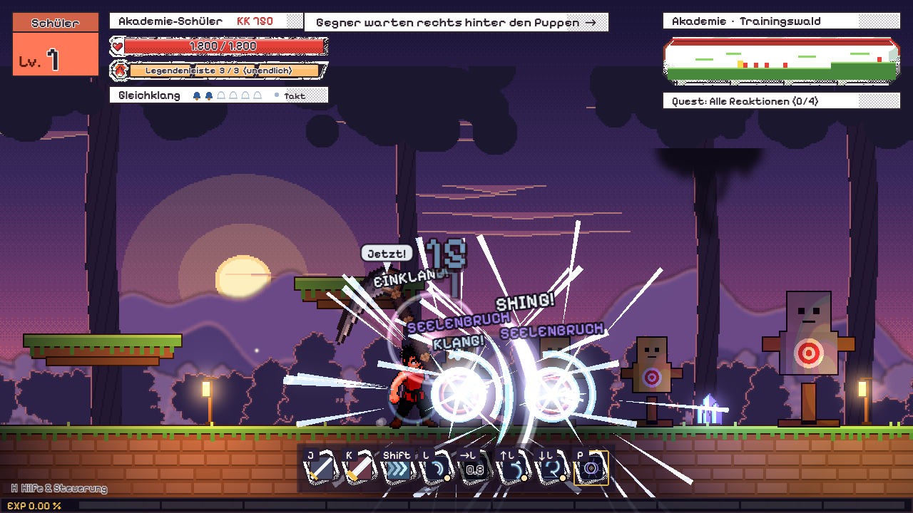
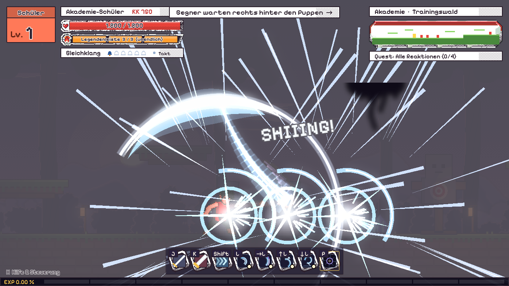
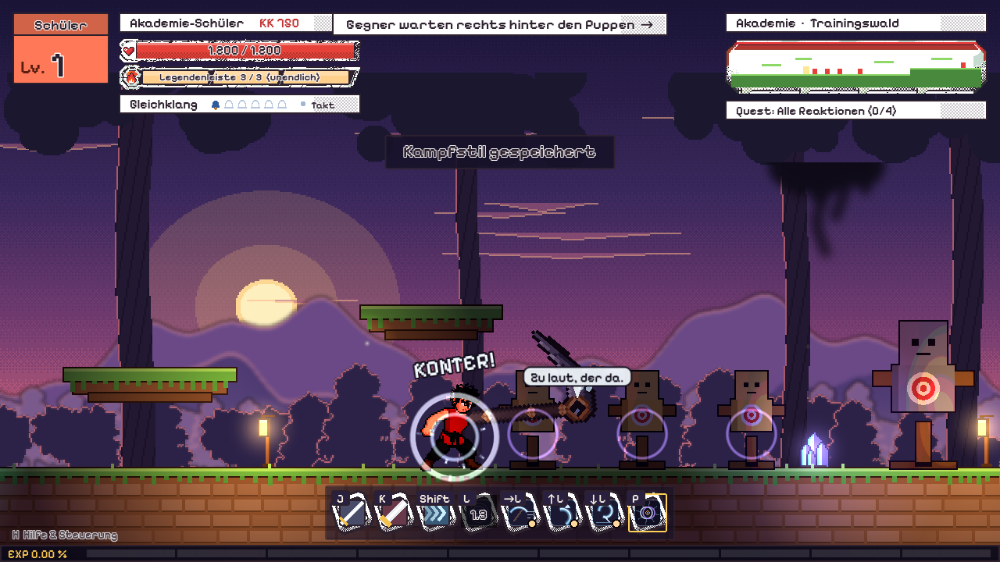

# Kampfstil „Gleichklang“

Konzept für einen spielbaren Kampfstil (Gacha, Legendär). Grundlage ist Kaisers
ausgefüllte Skillset-Vorlage vom 2026-11-04 („Seelenresonanz“). Mechanik, Aufbau,
Züge, Alternativen, Schwächen, Partner-Idee und Gacha-Regeln sind Kaisers Entwurf.
Geändert wurden nur Namen und Optik, die direkt aus einer bekannten Anime-Vorlage
stammen; sie sind hier durch eigene ersetzt (siehe „Was umbenannt wurde“ ganz unten).

Aufbau wie bei Glutatem und Schwarzmond: 6 Züge + Meisterzug mit 3 Varianten, je
Zug Grundform und 3 Alternativen (genau eine aktiv, vor dem Kampf gewählt).
Steuerung: L + Richtung = Zug, L halten = verstärkte Fassung (1 Stufe
Legendenleiste), P = Meisterzug (3 Stufen).

---

## Grunddaten

| | |
|---|---|
| **Name** | Gleichklang |
| **Kraft** | Seelenklang: Die Seele der Figur und die Seele der Sense schwingen auf derselben Frequenz. Je genauer der Takt, desto stärker der Klang |
| **Thema** | Zwei Seelen, ein Takt. Die Figur und ihre lebende Sense stimmen sich aufeinander ab und verwandeln präzise Sensenschwünge in gewaltige Seelenklingen |
| **Seltenheit** | Legendär (mehr Auswahl und Spektakel, keine höheren Werte als Episch) |
| **Heimatwelt** | *Hallgrund* (Arbeitstitel): eine Stadt aus Glockentürmen über einem nebligen Abgrund. Jede Stunde schlagen alle Glocken gleichzeitig; dazwischen hört man das Flüstern verirrter Seelen. Auf dem höchsten Turm liegt die *Stundenschule*, wo Lehrlinge und Waffengeister Paare bilden |
| **Waffe** | *Nachhall*: lebende Sense (siehe „Der Partner“) |
| **Spielgefühl** | Beweglich, mittlere Nahkampfreichweite, weite Bögen, Luftkombos und präzises Timing |
| **Gefühl wie** | Mut, Vertrauen und Konzentration gegen eine bedrohliche, verrückte Welt |

Kern des Stils (Kaisers „Unbedingt so“): der Partner, sichtbare Zusammenarbeit,
große Sensenbögen und der gemeinsame Klang.
**Bloß nicht:** eine wahllos wirbelnde Sense, und der Partner ist nie eine stumme
Waffe.

---

## Der Partner: Nachhall

Nachhall war früher die größte Glocke von Hallgrund. Als sie bei einem Sturz in
den Abgrund zersprang, schmiedete man aus ihrem Metall eine Sense, und ihr
Geist blieb darin wohnen.

- **Aussehen der Sense:** langer, dunkler Schaft mit Bronzebändern; das Blatt
  ist aus mattem Glockenmetall, an der Innenseite fein gerillt wie der Rand einer
  Glocke, die Spitze leicht hakenförmig. Am Übergang von Schaft zu Blatt sitzt ein
  **Klangloch**: eine kleine, runde Öffnung mit einem frei schwebenden
  Klöppel darin. Das Klangloch ist das „Gesicht“ von Nachhall. Es pulsiert im
  Takt, der Klöppel schwingt, wenn Nachhall spricht. Kein Auge, keine Zähne,
  kein Rot-Schwarz-Muster.
- **Persönlichkeit:** alt, trocken, ein bisschen eitel auf seinen Klang. Zählt
  den Takt laut mit, beschwert sich über schlampiges Timing, lobt selten, und
  wenn doch, dann leise. Beschützend, wenn es ernst wird. Verträgt kein Wasser
  („Rost!“).
- **Menschliche Gestalt (Siegposen, Story-Szenen):** ein hagerer, älterer Mann
  im schweren Glöcknermantel mit Bronze-Knöpfen, kurzer grauer Bart, ein Riss
  quer über eine Gesichtshälfte wie ein Sprung in einer Glocke. Bewusst ganz
  anders als ein lässiger Jugendlicher.
- **Sprachzeilen (Beispiele, kurz, je max. 1 s):**
  - Verstärkung bereit: „Jetzt!“ · „Hörst du's?“ · „Auf die Eins.“
  - Treffer im Takt: „Sauber.“ · „Na also.“
  - Takt verloren: „Raus aus dem Takt…“ · „Konzentrier dich!“
  - Meisterzug: „Zusammen!“ · „Lass sie klingen.“
  - Figur wird schwer getroffen: „Steh auf. Wir sind noch nicht fertig.“
- **Interaktion:** Ein kurzer Blick der Figur zum Klangloch ist die
  Bestätigungs-Animation, wenn Einklang voll ist.

---

## Stil-Mechanik

### Besondere Regel: Im gleichen Takt (Einklang)

Nachhall gibt einen **Grundtakt** vor (Start 100 Schläge pro Minute, also alle
0,6 s). Er ist dreifach sichtbar und hörbar: Das Klangloch pulsiert, ein dünner
Ring um die Figur zieht sich zusammen, und ein leiser Glockenton klingt.

- Jeder **verschiedene** Zug, der trifft, füllt **1 Stufe Einklang** (Leiste mit
  6 Stufen, dargestellt als 6 kleine Glocken). Derselbe Zug zweimal hintereinander
  füllt nichts.
- Trifft der Zug **im Takt** (Treffer im Fenster ±0,1 s um den Puls), gibt es
  **+1 Stufe zusätzlich** und einen hellen Glockenschlag. Normales Kombospielen
  bleibt also auch ohne perfektes Timing wirksam, nur langsamer.
- Bei **voller Einklang-Leiste** verstärkt der nächste gewählte Zug seine
  Reichweite oder Wirkung (Details bei den Zügen) und leert die Leiste.
- **Eingesteckte Treffer** unterbrechen die aktuelle Taktfolge (der Takt-Ring
  wird kurz grau, der nächste Treffer zählt nicht als „im Takt“), kosten aber nur
  **1 Stufe**, nicht die ganze Leiste.
- Ohne Treffer sinkt die Leiste nach 5 s um eine Stufe pro Sekunde.
- Der Einklang ist **unabhängig** von der Legendenleiste. L halten und voller
  Einklang lassen sich auf denselben Zug stapeln; dann gilt der stärkere Bonus
  plus +25 % Haltungsschaden.
- **Barrierefreiheit:** Optionen „Takt nur optisch“, „Takt nur akustisch“ und
  „Takt-Fenster großzügig (±0,15 s)“.

### Status-Effekt: Seelenbruch

Nur **verstärkte Abschlüsse** (voller Einklang oder L halten) verursachen
Seelenbruch: Die Haltung des Gegners (unsichtbare Widerstandsleiste der Gegner mit
Super-Rüstung, wie bei Schwarzmond) nimmt 3 s lang **+50 % Haltungsschaden**.
Ein erneuter Seelenbruch setzt die Dauer nur zurück auf 3 s, er verlängert sie
nicht darüber hinaus, und Bosse haben danach 6 s Ruhezeit, in der kein neuer
Seelenbruch greift.

### Kombi mit anderen Elementen

Gegen bereits **verlangsamte oder angehobene** Gegner ist der Takt-Ring 50 %
breiter (±0,15 s): Die weiten Sensenbögen lassen sich leichter ausrichten. So
passen Himmelsreigen und Zug 3 anderer Stile (z. B. Weißglut aus Glutatem) gut
zusammen. Der Kombo-Abschwächung unterliegt das trotzdem.

---

## Die 6 Züge

Werte sind Startwerte zum Ausbalancieren (Schaden in Prozent eines normalen
Leichtschlags = 100). Die **äußere Schneide** trifft bei allen Sensenzügen mit
+15 % Schaden; wer zu nah steht, trifft mit dem Schaft (−30 %). Das ist die
Sweetspot-Regel des Stils.

### Zug 1 – Sicheltakt (neutral)

Zwei kontrollierte Sensenbögen und ein weiter Abschlussschnitt. Schaden 80 + 80 + 150.
**Verstärkt:** der Abschluss hinterlässt einen hellen Bogen, der 0,3 s stehen
bleibt und erneut trifft.

| Alternative | Wirkung |
|---|---|
| Weiter Takt | Größere Bögen gegen Gruppen (Trefferzone +60 %), langsamere Ausführung |
| Kurzer Takt | Schnelle Schläge mit Schaft und Schneide (4 Treffer à 55) gegen nahe Gegner, keine Schaft-Abwertung |
| Schwerer Takt | Zwei langsamere Hiebe (2 × 170) mit hohem Haltungsschaden |

### Zug 2 – Seelensichel (vor)

Die Figur tritt vor und zieht die Sense quer durch den Bereich vor sich. Schaden 160.
**Verstärkt:** eine Seelenklinge verlängert den Schnitt um 80 % Reichweite.

| Alternative | Wirkung |
|---|---|
| Langer Bogen | +40 % Reichweite, 0,2 s längere Erholung |
| Rückholschnitt | Zweiter Druck auf L zieht die Sense zurück und trifft erneut (120), zieht leichte Gegner heran |
| Seelenwelle | Kein Nahkampftreffer, stattdessen eine kurze Energiewelle (ein Drittel Bildschirm, 130) |

### Zug 3 – Himmelsreigen (hoch)

Aufsteigender Sensenschwung, hebt leichte Gegner an. Erneutes Drücken lässt die
Figur hinterherspringen.
**Verstärkt:** Gegner bleibt 0,4 s länger in der Luft.

| Alternative | Wirkung |
|---|---|
| Hoher Reigen | Hebt einen Gegner besonders hoch, für lange Luftkombos |
| Breiter Reigen | Erfasst mehrere Gegner, hebt sie nur halb so hoch |
| Überkopfbogen | Starker Abwehrhieb gegen Gegner über der Figur (200), ohne Aufstieg |

### Zug 4 – Seelenlauschen (neutral + Abwehr)

Kurze Konzentrationshaltung: Die Figur schließt die Augen, Nachhall summt, und
die Seelen der Gegner werden als blasse Umrisse sichtbar. Perfekte Abwehr (erste
0,15 s, nutzt den vorhandenen Perfekt-Block) erlaubt einen ausweichenden
Gegenschnitt; zu frühes Abwehren reduziert nur Schaden (−60 %).
**Verstärkt:** Gegenschnitt mit Seelenbruch.

| Alternative | Wirkung |
|---|---|
| Gegentakt | Fenster nur 0,1 s, Konter dafür doppelt so stark |
| Schaftparade | Fenster 0,25 s, Konter nur 60 % Schaden |
| Klangantwort | Erfolgreiche Abwehr gibt +2 Stufen Einklang statt eines Konters |

### Zug 5 – Sichelschritt (vor + Bewegung)

Die Figur setzt den Sensenschaft auf und schwingt sich in einem kurzen Bogen nach
vorn. Ein Folgeangriff führt einen seitlichen Schnitt aus (110).
**Verstärkt:** doppelte Strecke, der Schaft hinterlässt einen Klangring, der nahe
Gegner kurz stoppt.

| Alternative | Wirkung |
|---|---|
| Stabsprung | Höherer Sprung zum Start einer Luftkombo |
| Seitentakt | Kurzer Schritt mit engem Ausweichfenster (Unverwundbarkeit 0,12 s) |
| Umlauf | Die Figur passiert den Gegner und dreht sich für einen Rückschnitt um |

### Zug 6 – Fallende Sichel (runter / Luft)

Eine Drehung in der Luft geht in einen diagonalen Abwärtsschnitt über (180).
Verfehlt der Schnitt, bleibt die Figur 0,35 s offen.
**Verstärkt:** beim Aufprall eine Klangwelle zu beiden Seiten.

| Alternative | Wirkung |
|---|---|
| Schwerer Fall | Steiler Sturz mit hohem Haltungsschaden |
| Wirbelbogen | Langsam sinkende Drehung, trifft mehrere Gegner |
| Sprungfolge | Ein Lufttreffer lässt die Figur leicht zurückfedern; nur einmal pro Luftkombo |

---

## Meisterzug – 3 Varianten

Alle drei kosten 3 Stufen Legendenleiste. Vor jedem Meisterzug rufen Figur und
Nachhall gemeinsam „Zusammen!“, und beide Hände greifen fest an den Schaft.

### Variante A – Erntebogen (gegen Gruppen)

Figur und Sense erreichen vollen Gleichklang. Eine riesige, gebogene Seelenklinge
aus blassblauem Licht verlängert das Blatt auf halbe Bildschirmbreite, und ein
einziger, sehr weiter Bogenschnitt trifft alle Gegner davor und darüber (600 je
Gegner).

### Variante B – Totengeläut (gegen ein großes Ziel)

Die Klinge verdichtet sich über 1 s zu einer schmalen, dichten, fast weißen
Seelenklinge. In dieser Zeit schlagen drei tiefe Glockentöne, bei jedem wird die
Klinge größer. Ein senkrechter Schnitt mit sehr hohem Haltungsschaden (900, Haltung
sofort leer bei Nicht-Bossen). Lange, gut sichtbare Vorbereitung.

### Variante C – Reiner Klang (Reinigung)

Nachhall schlägt einmal hell und klar wie eine frisch gegossene Glocke. Ein
Seelenschnitt breitet sich als Ring aus weißem Licht um die Figur aus: entfernt
alle negativen Zustände von der Figur, verursacht 350 Schaden und unterbricht nahe
Gegner für 0,8 s. Bosse werden nur unterbrochen (Angriff abgebrochen), nicht
betäubt.

### Großes Bild

Die Seelen von Figur und Nachhall erscheinen kurz als **zwei Klangringe**, die
sich überlagern und gleichschalten: Erst schwingen sie gegeneinander, dann
pulsieren sie im selben Takt. Drei Glockenschläge begleiten das Anwachsen der
Klinge. Beim Schnitt wird der Hintergrund dunkel, und die helle Sensenkontur bleibt
für einen Moment als weiße Linie stehen (Manga-Panel-Cut-in, dann zurück).

---

## Optik

- **Effektfarben:** Blasses Blau, Weiß, Violett, Schwarz, Rot nur als Akzent
  (Seelenbruch, verfehlter Takt)
- **Effekt-Stil:** scharfe Sichelbögen, pulsierende Seelenkonturen, sparsame
  musikalische Impulse (Klangringe, kleine Notenlinien im Bogen), weich animiert
  (M.U.G.E.N-Stil), Texturen grau und per Verlauf eingefärbt.
- **Lautmalerei:** „SHING“, „SWISH“, „KLANG“ (Glockenschlag: „DONG“)
- **Posen:**
  - Sense diagonal hinter dem Körper vor dem Antritt.
  - Beide Hände fest am Schaft beim Gleichklang.
  - Tiefer Ausfallschritt beim großen Abschlussschnitt.
  - Kurzer Blick zum Klangloch als Interaktion mit Nachhall.

## Schwächen

- Sehr nahe Gegner unterlaufen die optimale Reichweite (Schaft-Treffer −30 %).
- Große Schwünge sind bei Fehlschlägen angreifbar (Fallende Sichel, Schwerer Takt).
- Volle Stärke braucht Takt-Gefühl; Spieler ohne Timing füllen langsamer.

## Gacha

- **Banner:** „Ein Takt, zwei Seelen“
- **Duplikate:** nur Kosmetik: alternative Klangfarben (Bogen- und Ringfarben),
  Sensen-Spuren, neue Sprachzeilen von Nachhall und gemeinsame Siegposen. Keine
  Schadensboni.
- **Passendes Outfit (Creator):** *Lehrlingstracht der Stundenschule*: kurzer,
  dunkelgrauer Schultermantel mit Kapuze und Bronzeschnallen, hochgeschlossene
  Weste, Stulpenhandschuhe, schmales Glockenband am Handgelenk. Alternativ
  *Turm-Trainingskleidung*: ärmelloses Oberteil, Wickelhose, Bandagen.

## Skillpunkte

6 Züge à 1 SP + 18 Alternativen à 2 SP + Meisterzug 4 SP + 2 Varianten à 2 SP
= 6 + 36 + 8 = **50 SP**.

## Bedarf für den Einbau (später, noch nicht freigegeben)

- PixelLab: Sense Nachhall in 8 Winkeln = 8 Generierungen (mit Nachbesserung ca.
  12), Nachhalls Menschengestalt für Siegposen 2–4. Wird vor dem Start mit Anzahl
  angefragt.
- Code: Takt-Uhr (globaler Puls, Fensterprüfung), Einklang-Leiste mit 6 Glocken,
  Sprachzeilen-Blasen über der Sense (Text zuerst, Vertonung später mit Stable
  Audio oder Sprecher).
- Effekte im Code: Sichelbogen (Line2D/Shader), Klangringe, weiße Kontur-Linie
  für das Cut-in.

---

## Im Spiel (Stand 2026-11-04)

Spielbar im Trainingswald. Auswahl im Character Creator (Taste O), Zeile
„Kampfstil“: Gleichklang. Die Waffe wechselt dabei auf die Sense Nachhall.

- **Steuerung:** L + Richtung = Zug, L halten = verstärkt, P = Meisterzug,
  Tab = Stilmenü (Alternativen, Slots, Meisterzug-Variante). Erneut L während
  eines Zugs: Hinterherspringen (Himmelsreigen), Rückholschnitt
  (Seelensichel-Alternative), seitlicher Schnitt (Sichelschritt).
- **Standard-Slots:** neutral Sicheltakt, vor Seelensichel, oben Himmelsreigen,
  unten Fallende Sichel. Seelenlauschen und Sichelschritt per Tab-Menü in einen
  Slot legen.
- **HUD:** Einklang als 6 Glocken, daneben ein Punkt, der im Takt blinkt.
  Um die Figur zieht sich ein Ring bis zum nächsten Schlag zusammen, das
  Klangloch der Sense pulsiert, ein leiser Glockenton zählt mit.
- **Seelenbruch:** Statussymbol violett. Gegner nehmen 3 s lang +25 % Schaden
  (es gibt noch keine eigene Haltungsleiste), Brutes verlieren ihre Rüstung.
- **Code:** `scripts/gleichklang/` (Caster, Effekte, Welle, Meisterzug, Icons),
  Daten in `assets/combat/styles/gleichklang.json`.
- **Grafik und Ton ohne PixelLab:** Sense als Pixelbild aus
  `tools/gleichklang/gen_sense.py`, Glocken aus `tools/audio/synth_bell.py`.
  Beides kann später durch PixelLab-Bilder bzw. eigene Aufnahmen ersetzt werden.

---

## Was umbenannt wurde

Das Spiel verwendet nur eigene Namen, Figuren und Markenzeichen. Kaisers Mechanik
ist vollständig übernommen, auch die Idee des sprechenden Waffenpartners.

| Im Entwurf | Hier | Warum |
|---|---|---|
| Seelenresonanz – Hexenjagd | Gleichklang | „Seelenresonanz“ ist als Begriff fest mit der Vorlage verbunden |
| Resonanz-Leiste | Einklang | dito; Regel unverändert |
| Maka Albarn | „die Figur“ | Stil läuft auf der eigenen Creator-Figur |
| Soul / Soul Eater (Sense) | Nachhall, lebende Glockensense | Figur der Vorlage; eigener Charakter: alter Glockengeist statt cooler Jugendlicher |
| Sensenauge | Klangloch mit Klöppel | Das Auge auf der Sense ist ein Markenzeichen der Vorlage |
| Klaviertakt | Glockenschläge | Klavier und Jazz sind Souls Markenzeichen |
| Death City / Shibusen | Hallgrund, Stundenschule | Orte der Vorlage |
| Hexenjagd | Erntebogen | Technikname der Vorlage |
| Dämonenjagd (Kishin Hunter) | Totengeläut | dito |
| Genie Hunter | Reiner Klang | dito |
| Anti-Dämonen-Wellenlänge | reiner Glockenklang | Fähigkeit der Vorlage |
| Seelenlesen | Seelenlauschen | passt zum Klang-Thema, Wirkung gleich |
| Partnerwechsel (Alternative) | Umlauf | Begriff aus der Vorlage |
| Überlagerte Seelen-Silhouetten | zwei Klangringe, die gleichschalten | Bekannte Bildsprache der Vorlage |
| Schulkleidung mit langem schwarzem Mantel | Lehrlingstracht mit Schultermantel | Markenzeichen-Outfit der Vorlage |

### Namensvorschläge zur Auswahl

- **Stil:** Gleichklang · Zweiklang · Seelengeläut · Stundenschlag
- **Partner:** Nachhall · Bronn (alter Glockengießer-Name) · Hallmar · Klöppel (als Spitzname)
- **Heimatwelt:** Hallgrund · Glockenschlund · Stundenturm
