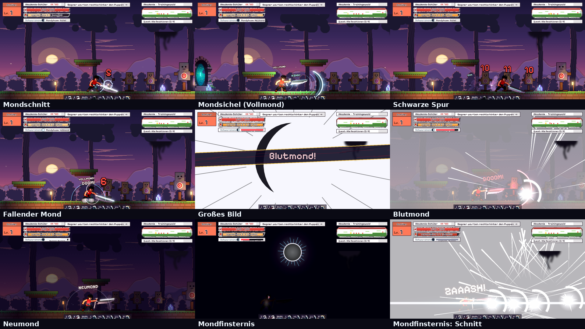
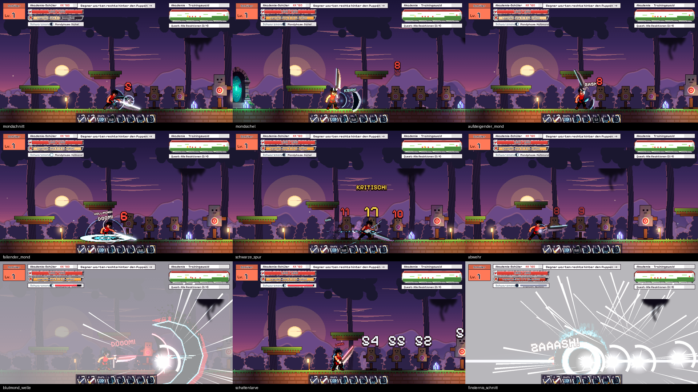

# Kampfstil „Schwarzmond“

Konzept für einen spielbaren Kampfstil (Gacha, Legendär). Grundlage ist Kaisers
ausgefüllte Skillset-Vorlage vom 2026-11-04. Mechanik, Aufbau, Züge, Alternativen,
Schwächen und Gacha-Regeln sind Kaisers Entwurf. Geändert wurden nur Namen und
Optik, die direkt aus einer bekannten Anime-Vorlage stammen; sie sind hier durch
eigene ersetzt (siehe „Was umbenannt wurde“ ganz unten).

Aufbau wie bei Glutatem: 6 Züge + Meisterzug mit 3 Varianten, je Zug Grundform
und 3 Alternativen (genau eine aktiv, vor dem Kampf gewählt). Steuerung:
L + Richtung = Zug, L halten = verstärkte Fassung (1 Stufe Legendenleiste),
P = Meisterzug (3 Stufen).

---

## Grunddaten

| | |
|---|---|
| **Name** | Schwarzmond |
| **Kraft** | Mondlast: Seelenkraft, die sich wie ein Gewicht in der Klinge sammelt |
| **Thema** | Neumondnacht: schwarze Mondsicheln, Finsternis, Mondphasen, Seelenfähren am Ufer zwischen Leben und Tod |
| **Seltenheit** | Legendär (mehr Auswahl und Spektakel, keine höheren Werte als Episch) |
| **Heimatwelt** | *Zwielichtufer* (Arbeitstitel): ein nächtliches Flussufer, über das Fährleute die Seelen bringen. Laternenboote, Nebel, ein Himmel, in dem der Mond fehlt |
| **Waffe** | *Mondbrecher*: großes Zweihandschwert mit breiter schwarzer Klinge, deren Rücken wie eine Sichel geschwungen ist; nahe dem Griff eine runde Aussparung (der „fehlende Mond“), Parierstange als halbe Mondscheibe. In der Neumond-Form wird daraus eine schlanke schwarze Klinge mit weißer Schneide |
| **Spielgefühl** | Aggressiver Nahkampf, weite Hiebe, schnelle Vorstöße, einzelne starke Fernangriffe |
| **Gefühl wie** | Entschlossenheit, innere Zerrissenheit, überwältigende Kraft zum Schutz anderer |

Kern des Stils (Kaisers „Unbedingt so“): großes Schwert, die sichelförmige
Energiewelle, Geschwindigkeit in der Neumond-Form und der Gegensatz zwischen
**kontrollierter** und **entfesselter** Kraft.

---

## Stil-Mechanik

### Besondere Regel: Mondphase

Eine kleine Leiste am Kämpfer zeigt eine Mondscheibe, die sich füllt:
**Neumond → Sichel → Halbmond → Vollmond**.

- Jeder **verschiedene** Zug, der trifft, füllt eine Phase. Derselbe Zug zweimal
  hintereinander füllt nichts (belohnt abwechslungsreiche Kombos wie bei Glutatem).
- Bei **Vollmond** wird der nächste Zug automatisch verstärkt und leert die Leiste.
  Was „verstärkt“ heißt, hängt vom Zug ab (größere Welle, zusätzlicher Nachschnitt
  oder längere Bewegung, Details bei den Zügen).
- Die Mondphase ist **unabhängig** von der Legendenleiste. L halten (Legendenleiste)
  und Vollmond lassen sich auf denselben Zug stapeln, dann gilt der stärkere Bonus
  plus +25 % Haltungsschaden.
- Ohne Treffer sinkt die Leiste nach 4 s um eine Phase pro Sekunde.

### Schattenlarve (Maskenfenster)

Nach **jedem** Meisterzug kriecht für **5 s** schwarze Tinte über eine Gesichtshälfte
und formt eine gehörnte Halbmaske mit feinen weißen Rissen; ein Auge glüht
dunkelrot. Das ist die „entfesselte“ Seite des Stils.

- Während der Larve füllt jeder Treffer eine Mondphase, auch derselbe Zug doppelt.
- Die Dauer lässt sich durch nichts verlängern. Das schafft ein klares, kurzes
  Angriffsfenster.
- Endet die Larve, zerfällt die Tinte zu Rauch; keine Strafe.

### Status-Effekt: Druckbruch

Nur **verstärkte** Züge (Vollmond oder L halten) verursachen Druckbruch:
dreifacher Haltungsschaden. Haltung ist die neue, unsichtbare Widerstandsleiste
von Gegnern mit Super-Rüstung (Brutes, Eliten, Bosse). Ist sie leer, verlieren sie
für 1,5 s ihre Rüstung und taumeln. Es gibt **kein** automatisches Betäuben bei
jedem Treffer.

### Kombi mit anderen Elementen

Die Mondsichel trägt bereits schwebende Gegner ein Stück weiter mit, statt sie
abzuwerfen. So verlängert sie Luftkombos anderer Stile (z. B. Weißglut aus
Glutatem hebt an, Mondsichel trägt weiter). Der Kombo-Abschwächung unterliegt das
trotzdem.

---

## Die 6 Züge

Werte sind Startwerte zum Ausbalancieren (Schaden in Prozent eines normalen
Leichtschlags = 100).

### Zug 1 – Mondschnitt (neutral)

Zwei weite Schwertschläge und ein kräftiger Abschluss. Zuverlässiger Einstieg in
eine Kombo. Schaden 80 + 80 + 140.
**Vollmond:** zusätzlicher dritter Schnitt, der eine kleine Sichel hinterlässt.

| Alternative | Wirkung |
|---|---|
| Breiter Mond | Langsamer, Bogen trifft mehrere Gegner (Trefferzone +60 %) |
| Schwarze Schneide | Schnelle, kurze Schlagfolge (5 Treffer à 45) gegen ein Ziel |
| Verdichteter Hieb | Aufladbarer Einzelschlag (bis 1 s), bis 260 Schaden und hoher Haltungsschaden |

### Zug 2 – Mondsichel (vor)

Schleudert eine sichelförmige Energiewelle nach vorn. Aus der Nähe treffen Klinge
**und** Welle, der Gesamtschaden ist aber auf 180 gedeckelt. Reichweite halber
Bildschirm. Geradlinig, kein Zielsuchen.
**Vollmond:** doppelt so große Welle, durchdringt Gegner.

| Alternative | Wirkung |
|---|---|
| Weite Sichel | Breite, hohe Welle, aber nur ein Drittel Bildschirm Reichweite |
| Schneidender Mond | Schmale, flache Welle mit ganzer Bildschirmbreite |
| Gehaltene Sichel | Kurz aufladbar (0,6 s): stärker (240), aber in der Ladezeit leicht zu unterbrechen |

### Zug 3 – Aufsteigender Mond (hoch)

Aufwärts geführter Hieb, hebt normale Gegner an. Erneutes Drücken lässt die Figur
hinterherspringen und in der Luft weiterkombinieren.
**Vollmond:** Gegner fliegt höher, Nachsprung mit zusätzlichem Schnitt.

| Alternative | Wirkung |
|---|---|
| Himmelsklinge | Höherer Start für längere Luftkombos |
| Mondbogen | Halbkreis-Hieb, trifft großen Bereich über dem Spieler |
| Steigende Sichel | Diagonale Mondsichel nach oben statt Nachsprung |

### Zug 4 – Entschlossene Abwehr (neutral + Abwehr)

Hält den Mondbrecher quer vor den Körper. Präzises Timing (die ersten 0,15 s) öffnet
einen kurzen Gegenangriff; zu frühes Abwehren reduziert nur Schaden (−60 %).
Nutzt den vorhandenen Perfekt-Block aus dem Kampfsystem.
**Vollmond:** Gegenangriff ist ein Mondschnitt-Abschluss mit Druckbruch.

| Alternative | Wirkung |
|---|---|
| Klingenparade | Perfekte Abwehr erlaubt einen sehr schnellen Gegenschnitt |
| Druckstoß | Erfolgreiche Abwehr stößt nahe Gegner zurück |
| Standhaft | Längere Abwehrhaltung (bis 1,2 s), aber nur schwacher Konter |

### Zug 5 – Schwarze Spur (vor + Bewegung)

Kurzer, extrem schneller Vorstoß, der ein schwarzes Nachbild zurücklässt. Ein
direkt folgender Angriff wird zum vorbeiziehenden Schnitt (die Figur landet hinter
dem Gegner).
**Vollmond:** doppelte Strecke und zwei Nachbilder, die kurz mitschneiden.

| Alternative | Wirkung |
|---|---|
| Durchbruch | Größere Distanz, längere Erholung |
| Nachbild | Kürzerer Schritt mit engem Ausweichfenster (Unverwundbarkeit 0,12 s) |
| Verfolgung | Diagonaler Schritt zu einem Gegner in der Luft |

### Zug 6 – Fallender Mond (runter / Luft)

Stürzt mit einem schweren Schnitt zu Boden, beim Aufprall entsteht eine kleine
Druckwelle. Verfehlt der Sturz, bleibt die Figur 0,4 s offen.
**Vollmond:** Druckwelle doppelt so breit, mit Druckbruch.

| Alternative | Wirkung |
|---|---|
| Mondsturz | Steiler Fall, starker Einzeltreffer |
| Schwarzer Regen | Feuert eine Mondsichel schräg nach unten und bleibt kurz in der Luft |
| Kreisender Fall | Drehender Hieb trifft mehrere Gegner, weniger Haltungsschaden |

---

## Meisterzug – 3 Varianten

Alle drei kosten 3 Stufen Legendenleiste. Nach jedem startet die Schattenlarve.

### Variante A – Neumond (die kontrollierte Kraft)

Die Klinge verdichtet sich zur schlanken Neumond-Form, der Mantel wird lang und
schwarz mit weißem Innenfutter. Für **8 s**: Züge 25 % schneller, Erholungszeiten
−40 %, Schaden nur +10 %. Die Stärke liegt im aggressiven Kombospiel.

### Variante B – Blutmond (die entfesselte Kraft)

Die Figur hebt die Hand vors Gesicht, die Schattenlarve schließt sich sofort, und
eine gewaltige schwarze Mondsichel mit dunkelrotem Rand rollt in gerader Linie
über die ganze Breite. Deutlich sichtbare Vorbereitung (0,7 s), großer Schaden
(900), danach Larvenfenster wie gewohnt.

### Variante C – Mondfinsternis (der letzte Ausweg)

Die Welt wird schwarz, nur ein weißer Ring wie bei einer totalen Sonnenfinsternis
bleibt am Himmel. Die Klinge zerfällt zu Schatten, die Figur steht als Silhouette
mit leuchtender Korona und führt einen einzigen, gewaltigen Schnitt, der die Arena
verhüllt. Sehr hoher Schaden (1600). Danach sind Mondphase, Legendenleiste und
Larve vollständig leer, und der Stil hat 10 s Erschöpfung (keine Verstärkungen).
**Einmal pro Kampf.**

### Großes Bild

Kurzer Nahblick auf Augen und Klinge (Manga-Panel-Cut-in), dann eine schwarze
Mondsichel über weißem Hintergrund. Beim Treffer kehrt die Farbe schlagartig zurück.
Kamerabeben nur 0,2 s, damit Angriffe danach lesbar bleiben.

---

## Optik

- **Effektfarben:** Schwarz, Weiß, Blau-Cyan, Dunkelrot (Rot nur bei Larve und Blutmond)
- **Effekt-Stil:** harte Energiesicheln mit flammenartig flackernden Rändern, kurze
  schwarze Nachbilder, feiner Nebel am Boden. Weich animiert (M.U.G.E.N-Stil),
  Texturen grau, eingefärbt per Verlauf.
- **Lautmalerei:** „ZASH“, „KSHH“, „DOOM“
- **Posen:** Schwert lässig auf der Schulter (Idle), tiefe Vorwärtshaltung vor der
  Schwarzen Spur, Klinge quer vor dem Körper (Abwehr), Hand vors Gesicht (Larve).

**Gewicht bewahren** (Kaisers „Bloß nicht“): Normale Schwerttreffer haben Hit-Stop
und kleine Funken, aber keinen Bildschirmeffekt. Bildschirmfüllend sind nur
Blutmond und Mondfinsternis. Neumond und Larve sind nie gleichzeitig mit
Mondfinsternis aktiv.

## Schwächen

- Verfehlte schwere Hiebe (Verdichteter Hieb, Fallender Mond) lassen den Spieler offen.
- Fernangriffe sind geradlinig und lassen sich überspringen.
- Starke Verstärkungen brauchen vorher aufgebaute Mondphase.

## Gacha

- **Banner:** „Der schwarze Mond“
- **Duplikate:** nur Kosmetik: andere Sichelfarben, Nachbild-Varianten,
  Ziehanimationen, Siegposen. Keine Schadensboni.
- **Passendes Outfit (Creator):** schwarzes Fährmanns-Gewand (weite Hose,
  gegürteter Überwurf, Laternen-Anhänger), langer Neumond-Mantel, Schattenlarve
  als Accessoire.

## Skillpunkte

6 Züge à 1 SP + 18 Alternativen à 2 SP + Meisterzug 4 SP + 2 Varianten à 2 SP
= 6 + 36 + 8 = **50 SP**.

## Im Spiel (eingebaut 2026-11-04)

- **Auswählen:** Character Creator (O), Zeile „Kampfstil“ auf Schwarzmond stellen.
  Danach im Trainingswald: L + Richtung = Zug, L halten = verstärkt, P = Meisterzug,
  Tab = Stil-Menü (Alternativen, Slots, Meisterzug-Variante). R setzt Abklingzeiten
  und die Mondfinsternis zurück.
- **Start-Slots:** neutral Mondschnitt, vor Mondsichel, oben Aufsteigender Mond,
  unten Fallender Mond. Entschlossene Abwehr und Schwarze Spur legt man im Stil-Menü
  auf einen Slot.
- **Code:** `assets/combat/styles/schwarzmond.json` (Werte), `assets/combat/movesets/schwarzmond.json`
  (J/K), `scripts/schwarzmond/` (MondCaster = Züge und Regeln, MondWave = Mondsichel,
  MondSuper = Meisterzüge, MondFx = Effekte, MondIcons = Icons). Haltung der Gegner in
  `scripts/enemies/enemy.gd` (`posture_hit`).
- **Abweichungen zum Konzept:** Bei Ladezügen (Verdichteter Hieb, Gehaltene Sichel)
  lädt L halten den Zug, statt die Legendenleiste zu verbrauchen. Waffe, Larve und
  Neumond-Klinge sind vorerst im Code gezeichnet (eigene Waffe noch nicht generiert).
- **Testlauf:** `tools/schwarzmond/probe.gd` spielt alle Züge und Meisterzüge durch und
  speichert Bilder (`xvfb-run godot --path . --fixed-fps 60 -s res://tools/schwarzmond/probe.gd -- <ordner>`).

## Effekte (PixelLab, 2026-11-04)

Zehn Skill-Effekte wurden mit PixelLab generiert (REST `/vfx`, Künstler *lite*, zusammen
12,01 Generierungen). Sie liegen unter `assets/vfx/schwarzmond/<id>/`: mondsichel,
mondsichel_treffer, mondschnitt, aufsteigender_mond, fallender_mond, schwarze_spur, konter,
schattenlarve, blutmond und mondfinsternis. `scripts/schwarzmond/mond_clip.gd` spielt sie ab.
Die Frames kommen aus dem Raster in `effect.json`, der Ankerpunkt aus `response.json`, und
im Hit-Stop pausieren die Clips. Fehlt eine Datei, bleiben die Code-Effekte aktiv. Das
Generator-Skript ist `tools/schwarzmond/gen_vfx.py`.

## Bedarf für den Einbau (später, noch nicht freigegeben)

- PixelLab: Mondbrecher und Neumond-Klinge, je 8 Winkel = 16 Generierungen
  (mit Nachbesserung ca. 24), Larve als Gesichts-Overlay 2–4. Wird vor dem Start
  mit Anzahl angefragt.
- Posen: Schulter-Idle, Ausfallschritt, Hand-vors-Gesicht; Rest aus der Posen-Bibliothek.
- Effekte im Code: Sichel (Line2D/Shader), Nachbild, Ring-Cut-in.

---

## Was umbenannt wurde

Das Spiel verwendet nur eigene Namen, Techniken und Markenzeichen. Kaisers
Mechanik ist vollständig übernommen.

| Im Entwurf | Hier | Warum |
|---|---|---|
| Zangetsu – Schwarzer Mond | Schwarzmond | Schwertname aus der Vorlage |
| Zangetsu (Waffe) | Mondbrecher | Eigene Form: Sichelrücken, Mondaussparung, Halbmond-Parierstange |
| Spirituelle Energie / Hollow-Kraft, Druckleiste | Mondlast, Mondphase | Verbindet Leiste und Thema |
| Getsuga Tenshō | Mondsichel | Signaturtechnik der Vorlage |
| Verzögerter / Aufwärts-Getsuga | Gehaltene Sichel / Steigende Sichel | dito |
| Shunpo | Schwarze Spur | Technikname der Vorlage |
| Hollow-Maske | Schattenlarve | Weiße Schädelmaske ist das Markenzeichen; hier schwarze Tinte, gehörnte Halbmaske |
| Bankai: Tensa Zangetsu | Neumond | Name und Form der Vorlage |
| Hollow: Schwarzer Getsuga | Blutmond | dito |
| Mugetsu (lange Haare, Bänder) | Mondfinsternis (Silhouette mit Korona) | Bekannte Verwandlung der Vorlage |
| Ichigo | „die Figur“ | Stil läuft auf der eigenen Creator-Figur |
| Karakura / Soul Society | Zwielichtufer | Orte der Vorlage |
| Shinigami-Gewand | Fährmanns-Gewand | Markenzeichen-Kleidung der Vorlage |
